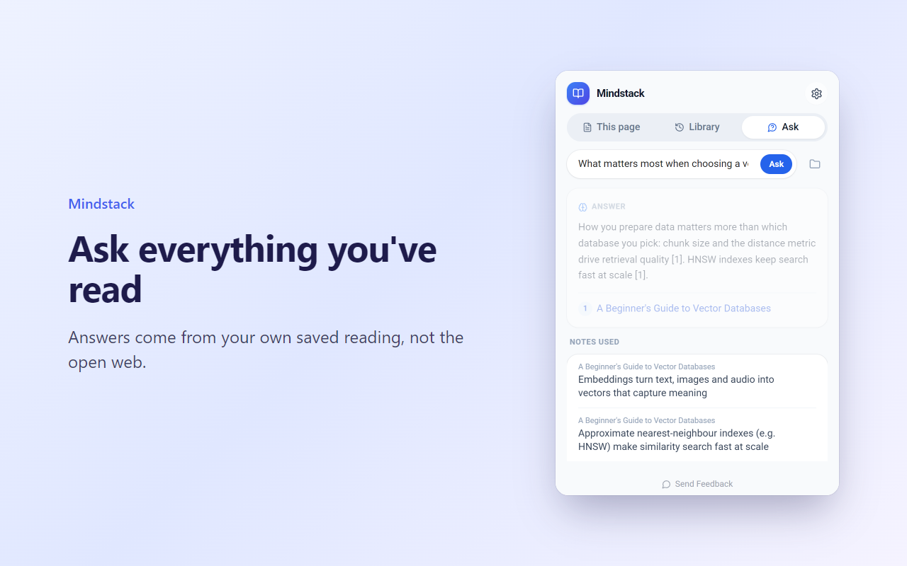
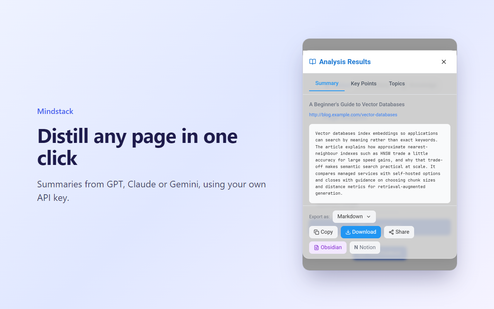
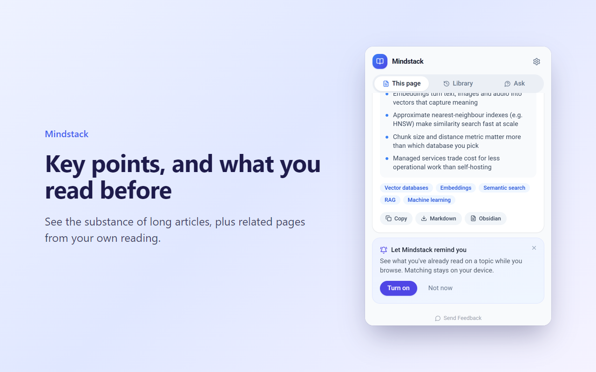
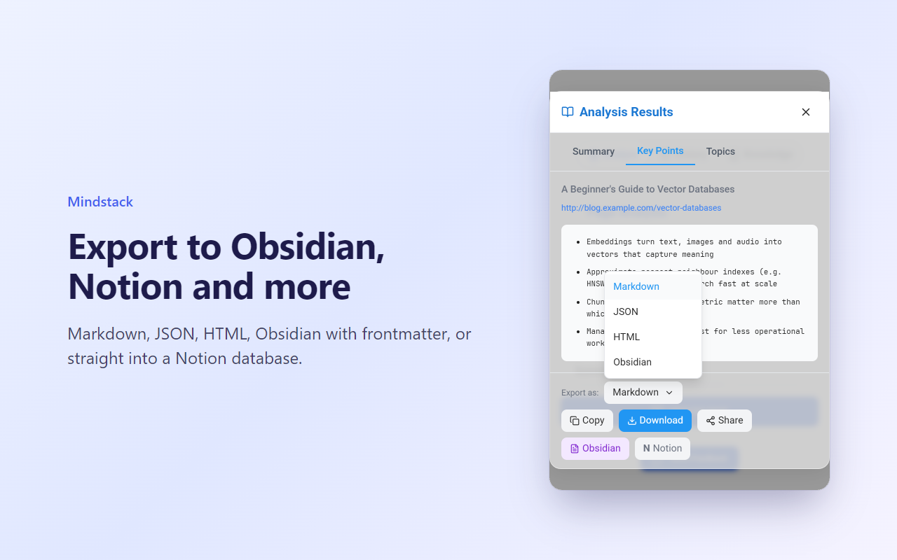

# Mindstack

**Turn everything you read into an AI knowledge base you can ask. Free for Chrome and Firefox. Bring your own key, no account, exports to Obsidian and Notion.**

*Formerly Research Assistant.*

Mindstack captures the articles, docs and papers you read, distills each one into a summary and key points with OpenAI GPT, Anthropic Claude or Google Gemini (your own API key), and builds a personal knowledge base you can search and ask questions across. Everything stays in your browser and can be exported to Obsidian, Notion, Markdown, JSON or HTML. No servers, no accounts, no tracking.

[Add to Chrome](https://chromewebstore.google.com/detail/research-assistant/idkghcjlmgaiodkjgfcfijjkdcoakanl) · [Add to Firefox](https://addons.mozilla.org/firefox/addon/research-assistant/) · [Website](https://smadgulkar.github.io/research-extension/)



## Features

- **A knowledge base that builds itself:** every page you analyze becomes searchable knowledge, organized into workspaces
- **Ask what you've read:** Q&A across everything you've saved, not the open web, with answers that cite the pages they came from
- **Open it and it's done:** click Mindstack on an article and it is summarized and saved, no buttons. Pages you saved before open instantly
- **Save without opening anything:** press Alt+Shift+S or right-click > Save page to Mindstack on any page
- **It reminds you:** opt-in suggestions show what you've already read on a topic, right on the page, and offer to save articles once you've read them. Matching runs on your device
- **One-click distillation:** summary, key points, topics and sentiment for the page you're reading
- **Your choice of AI:** OpenAI, Anthropic Claude or Google Gemini; the model list is fetched live from your provider
- **Free to start:** Gemini's free tier works with Mindstack ([get a key](https://aistudio.google.com/app/apikey)); on the free tier Google may use your inputs to improve its products
- **Obsidian export:** notes with YAML frontmatter, tags and wikilinks, sent straight to your vault
- **Notion export:** each analysis saved as a page in the database you choose
- **Markdown, JSON and HTML** copy and download

## Privacy

Page text goes directly from your browser to the AI provider you pick, using your key. Your history, knowledge base and settings stay in your browser's local storage. Read the [privacy policy](PRIVACY.md).

| | |
|---|---|
|  |  |
|  |  |

## Development

```bash
npm ci
npm run dev             # watch build into dist/, then load it via chrome://extensions → Load unpacked
npm run verify          # type-check, Chrome + Firefox builds, Mozilla lint, E2E tests
npm run screenshots     # regenerate docs/screenshots from the real UI
```

Releases are automated. See [RELEASING.md](RELEASING.md).

## Feedback

Found a bug or want a feature? [Open an issue](https://github.com/smadgulkar/research-extension/issues).

## License

Source available, not open source. Copyright (c) 2026 smadgulkar, all rights reserved. See [LICENSE](LICENSE).
