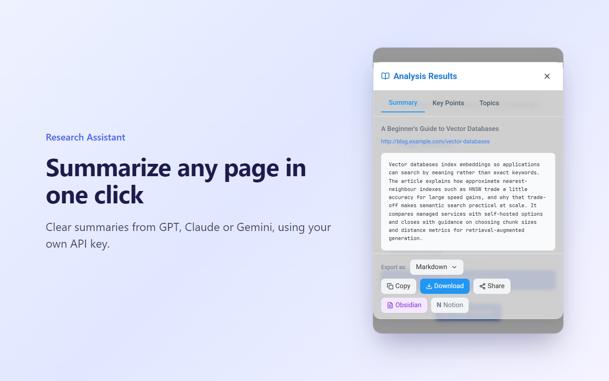
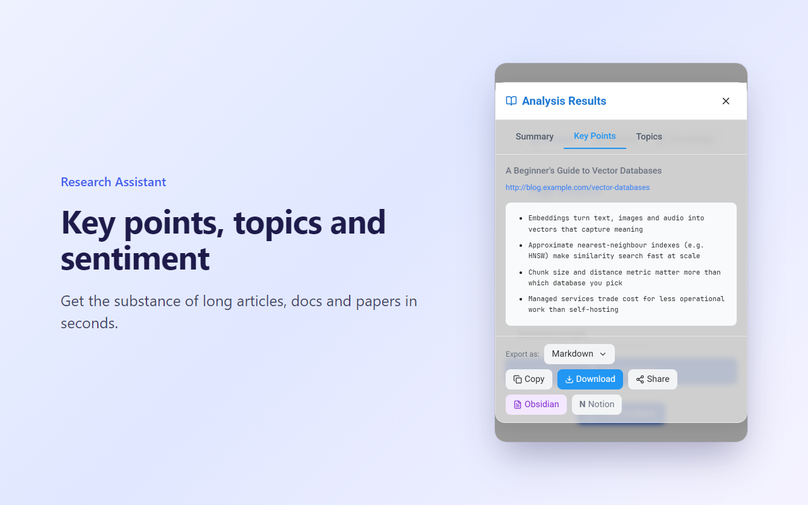
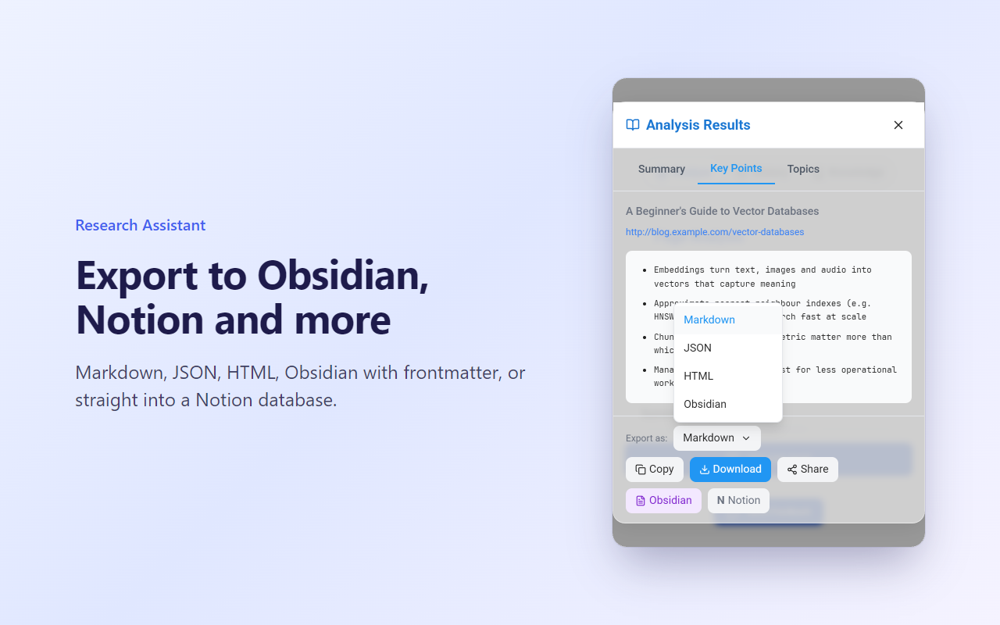
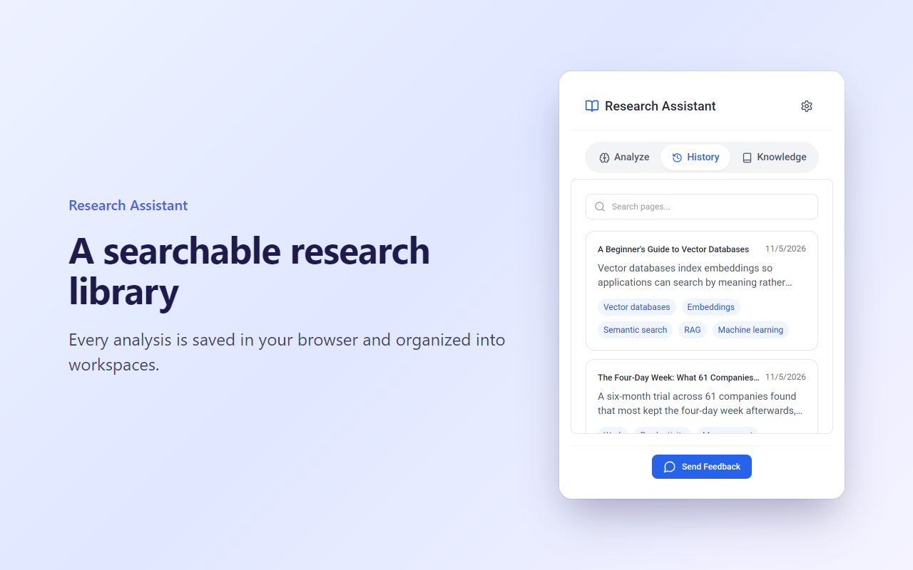
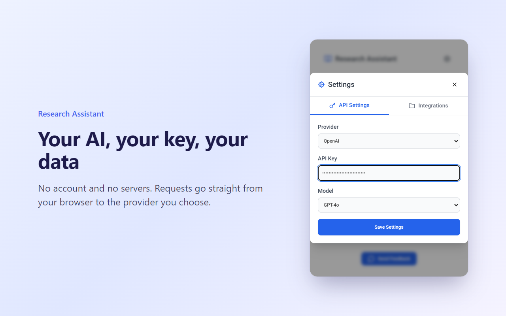

# Research Assistant

**Free AI webpage summarizer for Chrome and Firefox. Bring your own key, no account, exports to Obsidian and Notion.**

Summarize any article, doc or paper with OpenAI GPT, Anthropic Claude or Google Gemini, using your own API key. Every analysis is saved to a searchable library in your browser and can be sent to Obsidian, Notion, Markdown, JSON or HTML. There are no servers, no accounts and no tracking.

[Add to Chrome](CHROME_STORE_URL) · [Add to Firefox](https://addons.mozilla.org/firefox/addon/research-assistant@smadgulkar.github.io/) · [Website](https://smadgulkar.github.io/research-extension/)



## Features

- **One-click summaries:** summary, key points, topics and sentiment for the page you're reading
- **Your choice of AI:** OpenAI, Anthropic Claude or Google Gemini; the model list is fetched live from your provider
- **Research library:** searchable history, workspaces, and Q&A across everything you've analyzed
- **Obsidian export:** notes with YAML frontmatter, tags and wikilinks, sent straight to your vault
- **Notion export:** each analysis saved as a page in the database you choose
- **Markdown, JSON and HTML** copy and download

## Privacy

Page text goes directly from your browser to the AI provider you pick, using your key. Your history, knowledge base and settings stay in your browser's local storage. Read the [privacy policy](PRIVACY.md).

| | |
|---|---|
|  |  |
|  |  |

## Development

```bash
npm ci
npm run dev             # watch build into dist/, then load it via chrome://extensions → Load unpacked
npm run verify          # type-check, Chrome + Firefox builds, Mozilla lint, E2E tests
npm run screenshots     # regenerate docs/screenshots from the real UI
```

Releases are automated. See [RELEASING.md](RELEASING.md).

## Feedback

Found a bug or want a feature? [Open an issue](https://github.com/smadgulkar/research-extension/issues).
